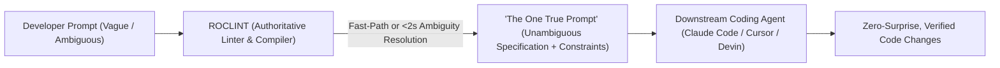
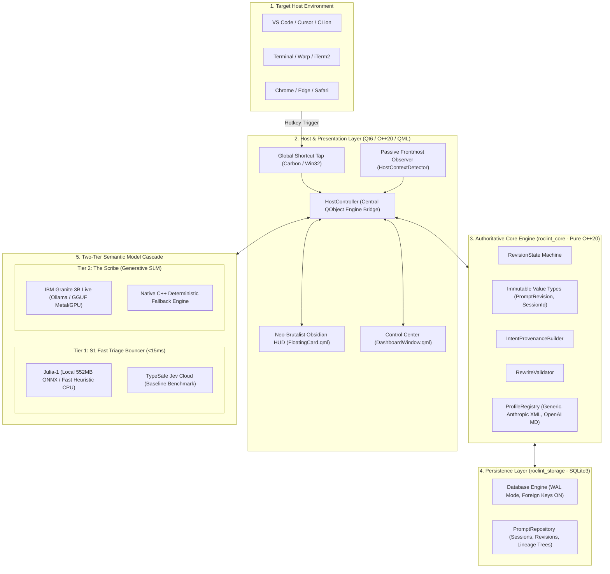

# Roclint — System Architecture, Design Invariants & Project Goals

> **Document Version:** 4.2.0  
> **Target Audience:** Engineering Review, System Architects, Autonomous Agents (Bob), and Core Contributors  
> **Status:** Stage 01 Complete — 24/24 Verification Suites Passing  
> **Repository:** `roclint` (`main` branch)

---

## 1. Executive Summary & Intended Goal

### 1.1 The Core Problem
Autonomous AI coding agents (Claude Code, Cursor, Devin, GitHub Copilot Workspace, Codex) possess immense generative capability, but suffer from a fundamental upstream failure mode: **Natural Language Ambiguity**.

When software engineers prompt coding agents, developer input is chronically underspecified:
- *"Fix the bugs in the project"* (Which bugs? Compile errors, runtime segfaults, logic edge cases, or test regressions?)
- *"Refactor the database queries"* (Optimize latency, enforce pooling, eliminate N+1 queries, or migrate ORMs?)
- *"Make the authentication stateless"* (Invalidate active sessions, migrate to JWTs, keep sticky session fallbacks, or update DB schemas?)

When an agent encounters underspecified instructions, it must make silent, arbitrary architectural assumptions. This causes:
1. **Destructive Code Mutations:** Modifying public APIs, rewriting unapproved subsystems, or deleting unrelated code.
2. **Compounding Agent Divergence:** Multi-turn autonomous loops amplify early false assumptions into project-wide regressions.
3. **Developer Fatigue:** Spending 20 minutes reviewing and reverting an 800-line git diff caused by a 5-word ambiguous prompt.

Traditional software linters (Clang-Tidy, ESLint, Clippy, Ruff) lint **source code after it is written**.  
**Roclint operates upstream:** it is a **real-time prompt compiler and authoritative linter** that intercepts developer intent at the OS invocation layer *before* downstream agents execute.



---

## 2. Core Philosophy & Architectural Invariants

Roclint is governed by seven non-negotiable engineering principles:

1. **Deterministic Upstream Governance:**  
   Every prompt transformation must be backed by an immutable provenance record (`ConfirmedIntent`, `RevisionState`, snapshot hash). Downstream agents receive verified constraints, not probabilistic guesses.
2. **Sub-15ms Local Latency (The Bouncer Pattern):**  
   Developers will not tolerate a 2-second delay on every keystroke. Clear prompts must pass through instantaneously (<15ms). Compute-heavy generative inference is reserved strictly for ambiguous decisions.
3. **100% Local Privacy & Air-Gapped Operation:**  
   Proprietary codebases and sensitive prompts must never leave the developer's machine unless explicitly configured. Decision scoring and SLM rewrite run entirely locally (Julia-1 ONNX on CPU + IBM Granite on local Metal/Direct3D GPU via Ollama/GGUF).
4. **Lightweight Resident Footprint:**  
   No heavy Electron shell, no background Node.js web servers, no lingering Python daemons. Native C++20 and Qt6 Quick footprint idling at ~40 MB RAM.
5. **Keyboard-First Cockpit UX:**  
   Invoked in $<5\text{ms}$ anywhere in the OS via global hotkey (`Cmd+Shift+L` on macOS / `Ctrl+Shift+L` on Windows). Resolves choices in 1–2 keystrokes (`1`, `2`, `Enter`) and auto-dismisses directly back to the editor.
6. **Strict Invariant Lineage (Anti-Staleness):**  
   Typing a single character in the editor invalidates pending asynchronous inference results (`DRAFT_DIRTY`). Late responses from old prompt states are rejected by hash verification.
7. **Non-Invasive Workspace Coexistence:**  
   Roclint never writes files into user projects, modifies `.git` trees, or hijacks parent directories without explicit consent.

---

## 3. High-Level System Architecture

Roclint is structured into five decoupled layers:



---

## 4. Layer-by-Layer Technical Breakdown

### Layer 1: Host & Presentation Layer (`app/host/**`, `app/qml/**`)
- **`HostController`:** The central hub bridging the headless C++20 core engine to the Qt Quick UI layer. Exposes reactive Q_PROPERTY bindings, manages worker subprocesses, and marshals thread-safe data transfer.
- **`FloatingCard.qml` (The Cockpit HUD):**
  - Frameless, neo-brutalist dark Obsidian interface (`#050505` background, `#161B22` panels, `#6E7681` slate borders).
  - Responsive down to $520 \times 360\text{px}$ with zero label clipping.
  - Interactive ambiguity badge: Shows real-time ambiguity score (e.g. `AMBIGUITY: 78%`), clarifying questions, and 1-click alternative pills.
  - Multi-palette theme engine (`dark`, `light`, `acid`, `amber`).
  - Direct engine switcher badge: Clicking `[ LIVE: GRANITE 3B ]` / `[ NATIVE C++ ]` toggles between live SLM and native C++ engine in-place.
- **`DashboardWindow.qml` (Control Center & Preferences):**
  - Card 1: Semantic Decision Scorer (Julia-1 ONNX model downloader, status monitor, Jev Cloud toggle).
  - Card 2: Rewrite Profiles (Generic, Anthropic Structured XML, OpenAI Structured Markdown, Local Compact).
  - Card 3: IBM Granite SLM (Live weights toggle, connected folder scanner, active model selector).
  - Card 4: OS Integration & Permissions (Clipboard capture, frontmost app observation, direct injection).
  - Card 5: SQLite History (Session timeline, revision diff viewer, restore, purge).
- **`ScreenPlacement`:** Native cursor tracking (`QCursor::pos()`), multi-monitor bounds detection, and safe display margin clamping.
- **`GlobalShortcutManager`:** Cross-platform global hotkeys using Carbon event taps on macOS (`Cmd+Shift+L`) and Win32 `RegisterHotKey` on Windows (`Ctrl+Shift+L`).

### Layer 2: Authoritative Core Engine (`include/roclint/**`, `src/core/**`)
- **Zero-Dependency C++20 Static Library:** Implements pure domain logic without Qt dependencies.
- **`PromptRevision` & `RevisionState`:** Immutable revision trees maintaining explicit parent-child lineage.
- **`InterventionStateMachine`:** Deterministic state machine governing when Roclint intervenes (`Quiet`, `Clarify`, `Manual`).
- **`MaterialityPolicyV1`:** Analyzes candidate choices and filters out trivial syntactic variations to present only architecturally material trade-offs.
- **`RewriteValidator`:** Rejects proposals whose `sourceSnapshotHash` or `baseRevisionId` does not match the active `ConfirmedIntent`.

### Layer 3: Persistence Layer (`src/storage/**`)
- **Embedded SQLite3 Engine:** Operates in `WAL` (Write-Ahead Logging) mode with `PRAGMA foreign_keys = ON`.
- **Database Schema:**
  - `sessions`: Session metadata, creation timestamps.
  - `prompt_revisions`: Immutable revision records, parent revision pointers, session references (`ON DELETE CASCADE`).
  - `schema_migrations`: Forward-only migration tracker.
- **Transactional Rollback:** All multi-row mutations execute in isolated transactions; failures leave authoritative history pristine.

### Layer 4: Two-Tier Semantic Model Cascade
Roclint solves the latency vs. intelligence dilemma through a progressive two-tier cascade:

```mermaid
sequenceDiagram
    autonumber
    actor Dev as Developer
    participant HUD as Roclint HUD
    participant S1 as Tier 1: S1 Bouncer (Julia-1)
    participant SLM as Tier 2: Granite SLM

    Dev->>HUD: Types prompt ("fix the bugs in the project")
    HUD->>S1: triagePrompt(text) [<15ms]
    alt Ambiguity Score < 0.70 (Clear Prompt)
        S1-->>HUD: fastPathClear = true
        Note over HUD: No interruption; ready to compile or pass-through
    else Ambiguity Score >= 0.70 (Ambiguous Prompt)
        S1-->>HUD: isAmbiguous = true (dimension: "action")
        HUD->>SLM: discoverOptions(req)
        SLM-->>HUD: ChoiceGroup: 1. Targeted Fix vs 2. Comprehensive Sweep
        HUD-->>Dev: Displays Clarification Options in HUD
        Dev->>HUD: Selects Option 1 (or hits Enter)
        HUD->>SLM: synthesizeRewrite(ConfirmedIntent)
        SLM-->>HUD: Compiled "One True Prompt" with AST constraints
        HUD-->>Dev: Prompt copied to clipboard; HUD auto-dismisses
    end
```

---

## 5. Supported Rewrite Profiles

Roclint compiles ambiguous user intents into strict prompt specifications using profile families registered in [`ProfileRegistry`](file:///Users/jesse/roclint/include/roclint/rewrite/RewriteProfiles.hpp):

| Profile ID | Target Agent / LLM | Structural Format |
|---|---|---|
| `GENERIC@1` | Universal (Claude, Copilot, Cursor) | Clean markdown envelope with explicit `/* ROCLINT [PROFILE: GENERIC@1] */`, resolved intent rationale, and boundary constraints. |
| `ANTHROPIC_STRUCTURED@1` | Claude 3.5 Sonnet / Claude Code | Strict XML envelopes wrapping prompt in `<task>`, `<context>`, `<resolved_choices>`, and `<constraints>`. |
| `OPENAI_STRUCTURED@1` | GPT-4o / o1 / Cursor | Markdown hierarchy with `# Goal`, `# Resolved Context`, `# Constraints`, and `# Deliverables`. |
| `LOCAL_COMPACT@1` | Local Small Language Models | Telegraphic key-value pairs (`GOAL: ... \n INTENT: ... \n LOCK: ...`) optimizing strict token budgets (<120 tokens). |

---

## 6. Current Implementation Status

All Stage 01 milestones are implemented, merged, and passing:

- **Automated Verification:** **24/24 CTest test suites pass 100% (0 failures)**.
- **Decision Scorer:** SupersonicLabs Julia-1 ONNX model weights (`552 MB`) downloaded and active for CPU inference.
- **Generative SLM:** IBM Granite 3B (`granite4.2:3b-q8_0` / `granite3.1-dense:2b`) integrated via Ollama with automated fallback to native C++ engine.
- **Cross-Platform:** Native compilation and verified runtime on macOS (Apple Silicon / Intel) and Windows 10/11.
- **Zero Dummy Data:** All hardcoded mocks removed; all HUD pills, toggles, history records, and download buttons reflect live system state.

---

## 7. Downstream Agent Integration Strategy

Roclint interacts with downstream agents through two progressive dispatch tiers:

1. **Tier 1 (Clipboard Handoff — Universal):**  
   Upon compilation, the verified prompt is committed to SQLite history, placed on the system clipboard, and the HUD dismisses instantly, returning OS focus to the developer's active editor for immediate `Cmd+V` / `Ctrl+V`.
2. **Tier 2 (Direct In-Place Accessibility Injection — Opt-in):**  
   Leverages platform Accessibility APIs (`AXUIElementSetAttributeValue` on macOS / UI Automation on Windows) to replace text in-place inside the target editor buffer without manual paste.

---

*Authored for peer engineering alignment between Jesse and Bob.*
