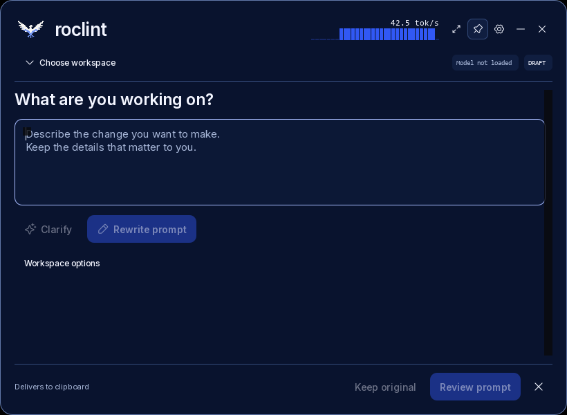
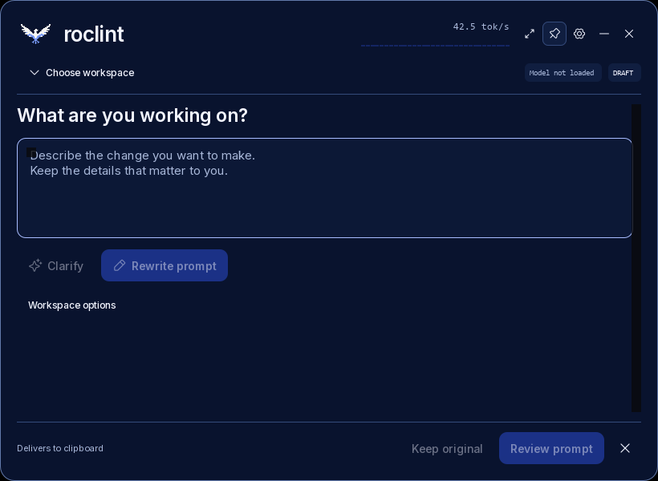

# Live generation meter

Date: 2026-11-07. User request: remove Technical details and turn the header pixel graphic into tokens-per-second / streaming visualization.

## Behavior

- Removed the Technical details action, raw diagnostic summary and its draft/revision counter binding from the HUD.
- Replaced the decorative PNG with `GenerationMeter.qml`: 32 stepped samples of actual token-arrival deltas, sampled every 200 ms. Heights scale against the recent peak, with a floor for quiet baseline. No random or sine-driven activity is used.
- The readout reports cumulative output tokens divided by measured decode time, matching the existing native speed definition. If decode time is unavailable, helper-reported generation duration is the fallback. It is not an end-to-end prompt-prefill latency measurement.
- No measurement yet: `— tok/s`. Pending/warming work: `Preparing…` (or `Working…` without native metrics), with the previous rate withheld. After completion: the last measured rate remains, with a flat inactive graph and a tooltip identifying it as the last decode speed.
- Stalled token arrivals contribute zero activity. A new request, cancellation, stop or failure clears live metrics. Reduced motion disables scrolling activity while retaining numeric updates. The readout cannot take keyboard focus; narrow labels are bounded/elided.
- During rewrite generation, friendly preparation/writing copy replaces raw JSON fragments. Approval and delivery remain explicit.

## Data path

`GraniteEngine` emits bounded four-token progress batches plus the final remainder, with cumulative `output_tokens`, `decode_ms` and `generation_ms`. Batched text now includes every byte since the prior callback; the old callback retained only each fourth token's piece. A persistent UTF-8 decoder handles Unicode split across batches.

The native worker validates request binding before accepting optional metrics. Counts are finite, integral, monotonic and bounded by the configured output cap; timing is finite and monotonic. Invalid telemetry is ignored without altering authoritative text validation. Metrics are scoped to the current semantic request, reset on dispatch/cancel/stop/failure and forwarded through the existing thread-safe facade to `HostController.generationTokens` and `tokensPerSecond`.

The protocol version, model instructions, sampling configuration, intent/proposal hash domains and final output acceptance are unchanged. Helpers without progress metadata do not get estimated or fabricated live token rates.

## Verification

- Release build of the host, native helper and native test targets: PASS.
- Full CTest: **52/52**, **118.18 s**; native runtime suite **13.91 s**.
- Final UI workflow rerun after preparation-state changes: PASS, **46.58 s**.
- Focused meter visual/regression check after final typography/bounds: PASS. Covers token deltas, no invented activity on stalls, counter rollback, reduced motion, literal measured rate and absence of the diagnostic action.
- Runtime fixture supplies 260 tokens / 1300 decode ms: reports 200 tok/s while BUSY before the final reply, resets between requests, ignores invalid metadata and clears genuine nonzero metrics on stop.
- Structure: 94/94 original paths preserved, zero errors. `git diff --check`: PASS.
- Native installed observation: no Technical details action; real local clarification and rewrite completed with displayed final decode rates of **220.5** and **181.8 tok/s** in this one synthetic session. These are observations, not a throughput benchmark or release-quality gate. The desktop captures observed final rates; before-completion behavior is separately verified by the bound runtime fixture.
- Native smoke stayed at an unapproved rewrite review. No prompt was approved, copied, inserted or submitted to another application. An existing blocking missing-detail guard required the supplied synthetic answer before rewriting; this change does not relax that guard.
- History backup remains local under ignored `build/manual-testing/history-before-stream-meter.sqlite3`; no history/prompt database is published.

## References

The user's crop is archived at `docs/research/roclint-ui-2026-11-07-streaming-meter-reference.png` (502 × 144). Implemented active/idle QML fixtures are alongside it. The active fixture deliberately supplies constant token arrivals and **42.5 tok/s synthetic data**; its plateau is not a fake real-model performance capture.

Project-root `design-qa.md` records the source comparison, native scope and remaining release work. macOS native execution and release installer acceptance remain outside this verification.
