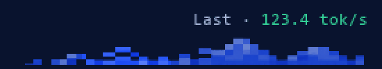
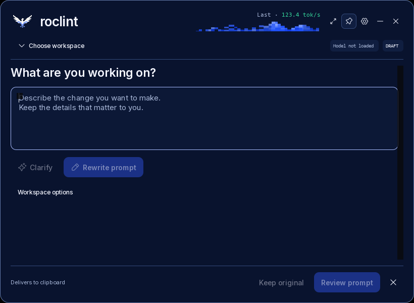

# Pixel-wave fidelity and short-burst visibility

Completed: 2026-11-08. User feedback: the equal-height token bars did not match the supplied layered pixel waveform, and fast generation was too brief to perceive.

## Result

The HUD reuses `assets/pixel-signal.png`, the original reference artwork, rather than approximating its silhouette with throughput bars. A clipped copy sweeps a highlight across the layered cobalt/periwinkle pixels. Token arrivals trigger the activity feedback; no random token rates are generated.

A burst remains visible for **1.8 seconds after the last token**, followed by a **0.7-second fade**. Completion does not reset that feedback immediately. This is a presentation afterglow; model results and review become available immediately. Completed rates use a **Last** prefix. Live numeric updates are limited to **two per second**, with the final value captured on completion. Reduced motion retains the reference artwork and readable rate without the sweep.

The normal meter uses up to 250 × 40 logical pixels; compact windows use a shorter version. The existing separate generation/decode rates, colors and Settings selector from newer work are preserved.

## Resume baseline and changes

The wave implementation was already committed as `4c683a1`. When work resumed, HEAD was `01e7ce7`, which also contained later audit/rewrite and dual-rate telemetry work. This verification builds that current checkout rather than installing the older November 7 executable.

The animation fixture now explicitly selects the single-generation display and compares visible label text independently of its color markup. This preserves the newer styled display while keeping the existing burst-timing assertions meaningful. No inference, approval, AST or hash behavior is changed by this resume.

## Verification

- Release host and product-alignment test target rebuilt successfully from the current checkout.
- Focused animation test: PASS. Covers a burst shorter than one display tick, 1.8-second hold, partial fade, completion, rate throttling, warmup, counter reset and reduced motion.
- Full product-alignment UI suite: **PASS**, **64.47 s** (CTest total 64.67 s). This is one UI test target, not a claim that the entire current repository test suite was rerun.
- Installed host matches the built host SHA-256: `3CAA62FA1B7202E5DDEAADDA78D01F9484F3F85C1E670E87C724E95E719BC65B`.
- Matching runtime files and helper deployed alongside the host; Python environment and model caches retained.
- Installed `--dry-run`: exit 0, all three QML roots loaded, no stderr, with Qt removed from PATH and no QML import overrides.
- Computer-use observation: normal installed Roclint window opens with the reference waveform and no Technical details action. No prompt was approved, copied, inserted or sent during this verification.
- Structure check and `git diff --check`: PASS.

## Visual evidence

Source: `docs/research/roclint-ui-2026-11-07-streaming-meter-reference.png`, 502 × 144 pixels. The same reference was attached again for this correction.

Implementation: `docs/research/roclint-ui-2026-11-08-pixel-wave-implemented.png`, an 820 × 600 Qt render at DPR 1. The animated preview crops its header to 275 × 50 and scales to 550 × 100 with nearest-neighbor sampling. It records six actual renderer frames from a synthetic short burst. **123.4 tok/s is fixture input, not a benchmark.**

The source, full window and multiple sweep positions were inspected together. The layered silhouette, stepped pixels and colors now come from the source asset itself. The displayed rate and brief afterglow are intentional functional additions. Model execution is not slowed to make the animation visible.

The installed desktop/Start menu entry continues to target `%LOCALAPPDATA%/Programs/Roclint/Roclint.exe` directly. Installer, onboarding and macOS release acceptance remain separate work.
