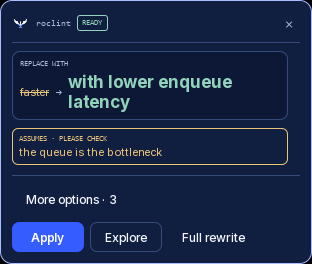

# Quiet companion interaction — November 16, 2026

## Scope and evidence

This pass responds to the user's two supplied screenshots of the installed
Windows app. The product goal is help beside the existing draft, with the
navy/cobalt rounded Roc-bird identity retained. Source screenshots were copied
unchanged and inspected in `D:\codex-evidence\roclint-quiet-companion-20261116`:

1. `01-unsolicited-popup.png`: typing/empty-composer view — poor. A large Checking
   card and a separate wide Check prompt badge compete with the editor. The card
   obscures content before a useful suggestion is available. It also labels
   "Codex" as draft content while the composer appears empty; this suggests a
   provider/capture issue but the screenshot cannot prove its cause.
2. `02-technical-review.png`: expanded rewrite review — poor. Internal audit
   uncertainty and a `prohibit_boundary_1` identifier appear as if they were a
   user's answer. A broad creative-style heading describes a Step-by-Step version,
   and a technical all-caps banner competes with the actual rewritten prompt.
   The text also appears thin; exact font rendering and accessibility contrast
   require separate native inspection.

The controls keep the user in charge of applying a change, and the established
palette/logo are recognizable. The interaction hierarchy is the problem: ongoing
work and internal machinery occupy more space than the useful recommendation.
These findings are limited to the supplied states, not a full accessibility or
Grammarly product-parity audit.

## Implemented direction

- Automatic help is one 28-by-28 logical-pixel Roc indicator. No wide label or
  separate close button; a delayed tooltip explains the action and right-click
  dismisses it for this draft. The existing global shortcut remains the keyboard
  route to the full review.
- Loading, background results and failures never open a card by themselves.
  Clicking the indicator opens the current phrase suggestion or requested status;
  when no local result is available it explicitly opens full-prompt review.
- Only one adjacent surface is visible: the indicator hides when its card or the
  full HUD is open. New text/field changes clear the open-card request. Dismissed
  or superseded requests cannot reopen it via a late callback.
- Native placement first tries outside the editor (right, below, above, left),
  avoiding its Send controls when space exists. A screen-filling editor can leave
  no outside space; the icon then clamps at the field edge. Native per-monitor
  scaling from the earlier pass is retained.
- Requested phrase cards narrow from 376 to 312 logical pixels. Short suggestions
  no longer have an opaque black scrollbar track. Assumptions remain
  visible, exact Apply/readback stays required, and Explore cannot interrupt a
  pending insertion. The interview and whole-prompt rewrite remain explicit.
- Unmatched audit rows use a plain review instruction, retain the original audit
  explanation behind Why review, and no longer expose internal IDs as answers.
  Required acknowledgments, independent review and approval bindings are intact.
  Alternative versions and review-state banners use direct language.

## Boundaries

This pass does not implement in-editor word underlines. Reliable underlines,
hover hit-testing and low-latency range updates require editor-specific support
or integrations; a generic accessibility overlay is not proof those capabilities
exist across IDEs. It also does not resolve the possible empty-composer/provider
capture issue, font rendering, all review hierarchy issues or model option quality.
The larger interview/review remains a substantial interface requested explicitly.

## Verification and deployment

Release build passed. The focused companion UI run passed, including left-click
open and right-click dismiss on the real 28-pixel QML indicator; its non-activating
window flag and exact dimensions are checked. Generated icon and phrase-card
previews were visually inspected. Full enabled CTest passed **66/66, 300.84 s**;
the real-embedding integration target remains disabled. The final scrollbar-only
QML follow-up was rebuilt and the focused companion UI run passed again.
Structure and whitespace checks pass. The existing pinned llama MSBuild warning
is unchanged; build success is not a claim of zero warnings.

The installed host SHA-256 is
`E8D3FAAC6EF278D4F7F9740E0F6417FB4E9FD2B5672D3295EF5F1CAE656CCB2C`.
Source and installed hashes match. Windows-platform startup smoke passed exit 0
without developer Qt on PATH. Only the host executable was replaced; the unchanged
v16 native worker/configs, weights, preferences and history were preserved. The
previous host is backed up in the evidence directory. The owned diagnostic host
was replaced while no Roclint draft window was exposed, then started explicitly
with `--background` so the update did not open a HUD.

Live observation in the disposable Win32 editor at 200% scaling confirmed one
small bird outside the field, with no automatic card/HUD during or after completed
model work. UIA readback retained the original synthetic draft, proving this test
did not silently insert a replacement. The editor was minimized afterward.
`live-quiet-verification.json` records scope and limits. Computer Use still cannot
select the non-activating surfaces, so native click-to-open was not repeated;
actual QML mouse routing plus the controller's explicit-open gates are tested
separately. The prior v16 manual Apply pass is historical and is not claimed as a
fresh insertion pass for this host build. Native macOS and mixed-monitor tests
were not run. Model contracts are unchanged; no new quality corpus run is claimed.

No commit or push was made. Existing uncommitted work and original research assets
are preserved.

## Rendered references

These are the actual QML components rendered by the test application, not images
of an installed native interaction. Only the icon is automatic; the phrase card
is opened explicitly. The fixture contains an optional assumption, kept visible
because it changes the meaning of the replacement.

