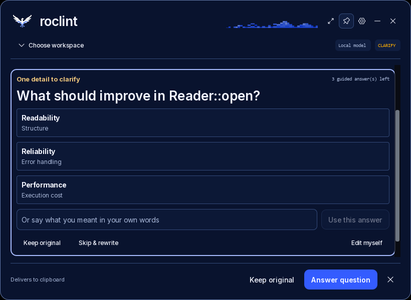
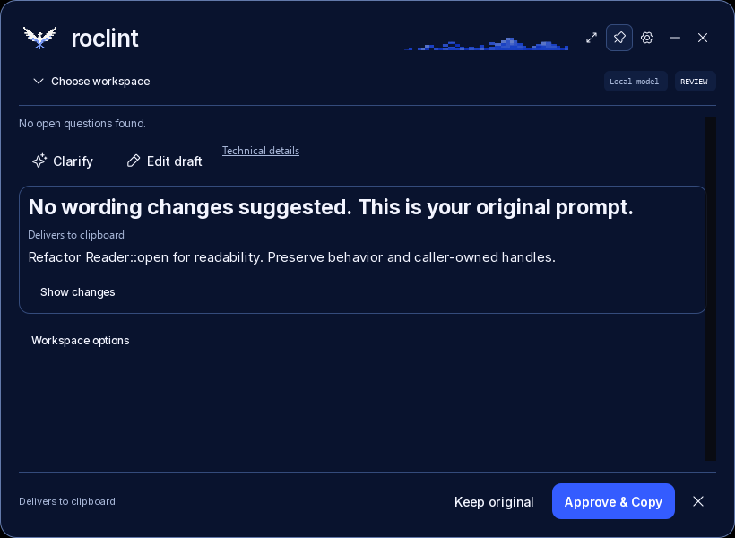
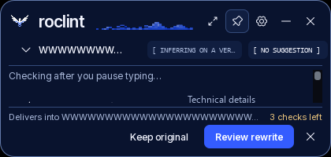

# Native Windows launch and initial HUD refresh

Date: 2026-11-07. Base: `8605767` on `feat/codebase-decoupling`, pushed before this work. UI/launch work is isolated on `feat/roc-hud-refresh`.

## Delivered locally

The Start menu **Roclint** entry and desktop **Roclint** shortcut target `C:/Users/kirby/AppData/Local/Programs/Roclint/Roclint.exe` with no arguments. Both use the embedded Roc icon. Launch does not use BAT, PowerShell, a terminal, the repository working directory or a test fixture prompt. The application retains its existing user settings, history and model caches.

The Windows executable now uses the GUI subsystem. Ordinary launch activates the HUD without requesting a new editor capture; a repeated launch uses the existing resident host. Closing the HUD hides it; tray Quit exits. The manual HUD is a normal app window while a bound editor companion remains a tool window. Explicit background-only launch remains available without enabling login startup.

The first UI slice implements the approved rounded ink-blue Roc direction: bundled reading font, real Roc/signal assets, official icon controls, larger question choices, custom answers, an explicit rewrite request, skip/rewrite, original preservation, full prompt/diff toggle and persistent approval actions. New hover transitions respect reduced motion. Empty drafts disable actions that need text. Settings shares branding/colors; its full redesign remains pending.

## Verification

| Check | Result |
|---|---|
| Release host and native test-target rebuild | PASS |
| Full CTest | 52/52, 103.57 s |
| Final presentation-only rerun | `roclint_product_alignment`: PASS, 46.31 s, after empty-state and literal-ampersand repairs |
| Structure | 94/94 original paths retained, 0 errors |
| Windows PE subsystem | 2 (GUI) |
| Deployed startup | `--dry-run` loads all 3 QML roots and exits 0, with Qt removed from PATH and no QML import overrides |
| Shortcut inspection | Both direct executable targets, empty arguments, embedded icon |
| Native installed launch | Normal targetable `Roclint — prompt assistant` window; no console; empty prompt and disabled empty-state actions verified through screenshot + accessibility |
| Native close/reopen | Closing removes the visible window while resident PID 2388 remains; launching again restores window 199236 with the same PID and no second resident instance |
| Unrelated user document | SHA-256 remains `F9A476694DA58402F4C7CFE3C1306D8B842AF9B276C6BA87A9528B6327558EDD`; excluded from this work |

The new workflow regression requests a rewrite from an unsaved HUD draft, verifies one discovery and one unapproved preview, then reactivates the retained draft without another model call. Existing tests continue to cover keyboard choice/review, long labels, four HUD sizes, bounded diffs, no implicit acknowledgement, skip without invented answers, custom answers and no unapproved delivery.

Build/test logs and raw QML captures are under ignored `build/manual-testing/`. These records are development evidence, not clean-machine or real-model quality certification. An attempted offscreen smoke test first failed because that plugin is intentionally absent from the Windows deployment; the successful deployment check used the packaged native Windows platform instead.

## Visual evidence

See project-root `design-qa.md` for reference comparison, typography, spacing, tokens, assets, content, repaired findings and scope.

## Remaining release work

This is an installed local development copy, not a signed release installer. The staged Julia venv still refers to this computer's Python/system packages; portable runtime packaging, first-run model setup, signing, upgrade/rollback and uninstall need clean-machine acceptance. Full settings/onboarding redesign remains separate. macOS and new native insertion compatibility are not established by these results. Prior model-quality acceptance limitations remain unchanged.

The deployment procedure and release gates are recorded in `docs/plans/2026-11-07-windows-app-delivery.md`.
