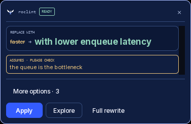
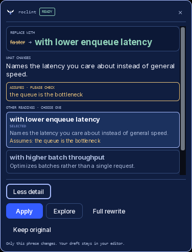
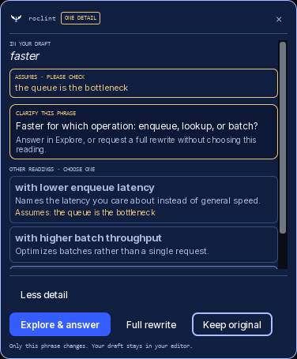

# Word companion implementation — November 16, 2026

Branch: `topic/integration-2026-11-15`. Base commit: `30929c9`, plus the
previously tested, uncommitted hands-on repairs documented in
`hands_on_companion_2026-11-16.md`. Those changes are preserved.

Selected reference: **Word-level companion** in
`docs/research/2026-11-14-inline-companion-concepts.html`.

## User-facing behavior

- The first view leads with the original phrase and model-proposed replacement.
  **Apply**, **Explore** and **Full rewrite** are directly available. The close
  control keeps the original wording.
- **More options** reveals the explanation and alternate readings. Any proposed
  assumption remains visible in the compact view, before Apply. The model still
  supplies all replacements, alternatives and explanations.
- A clarification-dependent reading cannot be applied. Explore opens the
  question flow; Full rewrite requests a rewrite without selecting that reading.
  Existing host checks still block unresolved required details/conflicts.
- The popup retains the ink-blue/cobalt palette, rounded card, pixel Roc mark,
  monospace labels and readable replacement text. It uses a short appearance
  fade and honors reduced motion. Long content scrolls inside the popup.
- Inline requests now warm a cold native runtime. Pending work stays bound to
  the latest field text and caret span; there is no fabricated loading suggestion.
- Resizing the popup repositions it through the existing screen-placement helper.
  The window continues to reject keyboard focus.

## Rewrite and insertion boundaries

`openRewriteFromCompanion(expectedVersion)` validates the current word request,
field identity, text hash, workspace, pipeline and revision version. The queued
operation checks the field again before and after opening the captured session.
Only then does it ask the HUD to continue the explicit rewrite request. It does
not open the interview, select an alternative, approve, insert, copy or send.

Apply continues to use the existing exact-range injection contract. A model
suggestion does not permit replacing another field or an edited draft. The
independent sentence audit and full-rewrite reread/approval gates remain intact.

## Rendered references

These are screenshots of the real QML components with **synthetic test data**,
not claims about real-model suggestion quality or universal IDE support.

## Verification

Focused QML tests passed for compact/details/clarification/actions and for the
real-controller popup-to-full-rewrite path. The native-protocol suite passed
with cold inline startup, stale-version refusal, exact range request boundaries
and no automatic full-field insertion. Its embedding/model responses and range
bridge are synthetic; it is not a live-model/native AX readback claim.

Final explicit Release build: exit 0. Built production host dry-run with an
in-memory database: exit 0. Complete enabled CTest suite: **65/65 passed**,
341.66 s, with UI screenshot artifacts enabled. Real embedding integration is
still disabled. Structure: 94/94 original paths, zero errors; whitespace check
clean. Python was not rerun; its sources and dependencies were not changed.

Receipts, logs, source hashes and an immutable staged host are in
`D:\codex-evidence\roclint-word-companion-20261116`.

## Installation status

**Installed and started.** Re-launching the resident app restored the previously
minimized window through its normal activation path. Its visible review still
contained only the synthetic music-app test, so that test instance was restarted
for the update. The previous executable was backed up. Installed host SHA-256:
`C4AD877E1496CC060491EAF971F4B9915BBD4140B1D4EFFBCCF40A1C1FFB6AB1`.
Installed-app Windows-platform dry-run passed (exit 0) with developer Qt paths
removed. Settings, history, model files and Python environments were retained.

The updated app was launched and its empty HUD verified. The pre-existing
disposable native editor still held the synthetic plant-photo test. Computer Use
refused two attempts to change that field with `user input was detected in this
window`; subsequent observation found the fixture minimized. Further input was
paused for a coordinated test. The native worker was running, but this alone does
not establish suggestion quality, Apply/readback correctness or latency.

`installation-receipt.json` records the installed checksum and startup result.
Live insertion verification is still pending; no executing-AI prompt was sent.

## Scope and remaining work

This is a caret-anchored companion using existing accessibility capture. It does
not implement editor-wide underlines, plugin APIs, multi-span issue navigation,
universal contenteditable support or macOS range insertion. Model cold load and
two-pass wording latency still need measurement and optimization. This UI work
does not establish that creative questions or downstream artifacts are better.

Existing research references and the app's settings, models and history are
preserved. No commit or push is part of this change.

## Live follow-up

Refreshing Computer Use and selecting a fresh disposable editor restored control.
The initial v13 live test offered a relevant performance clarification, but asked
an unnecessary confirmation about an obvious typo. That finding led to the
[v14 word-action correction and real-model check](word_action_quality_2026-11-16.md).
The historical C4 installation checksum above belongs to the original UI build;
the follow-up report records the subsequent matching host/worker deployment.
