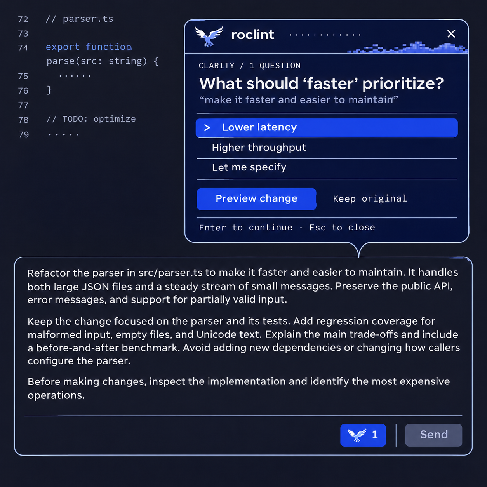
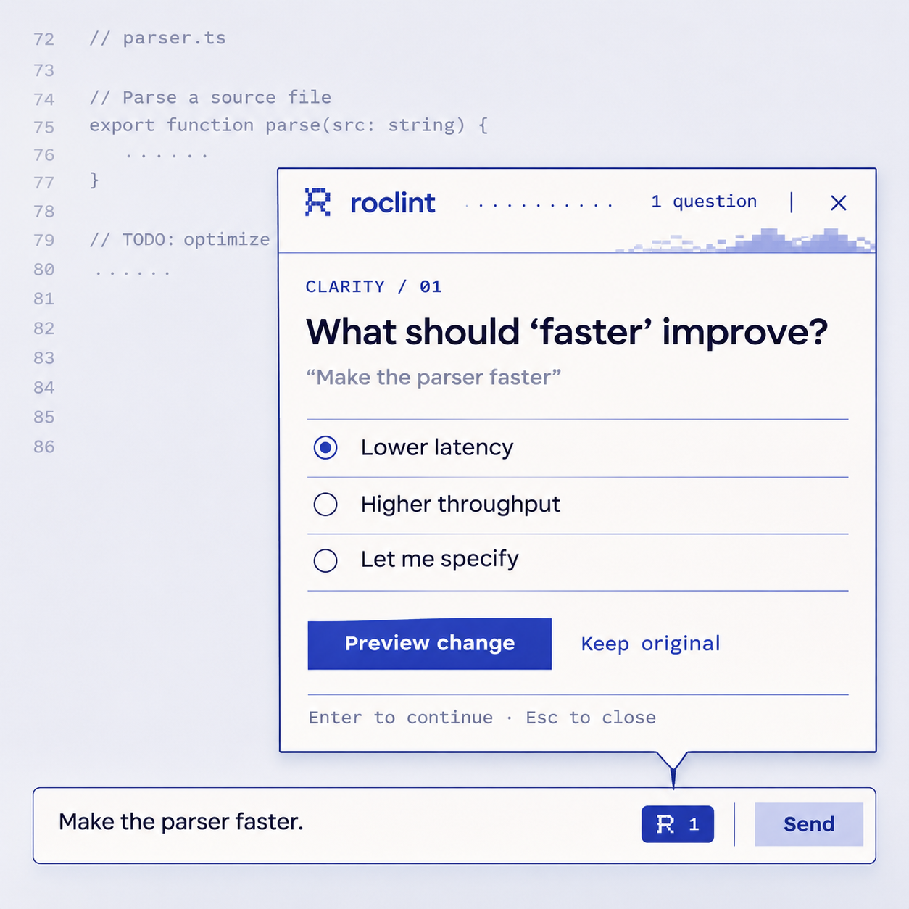
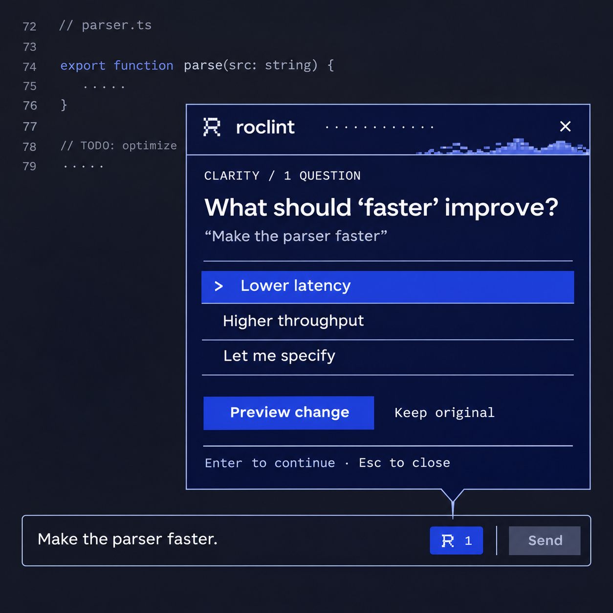
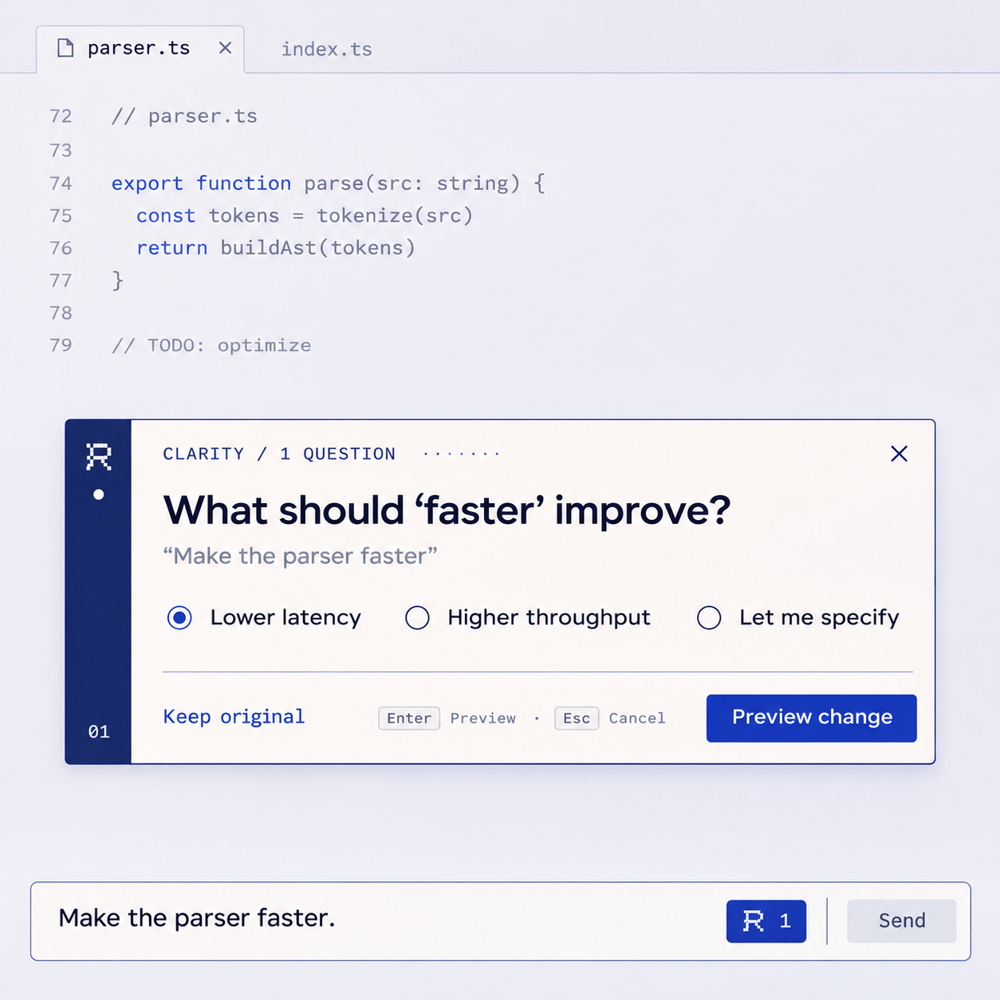
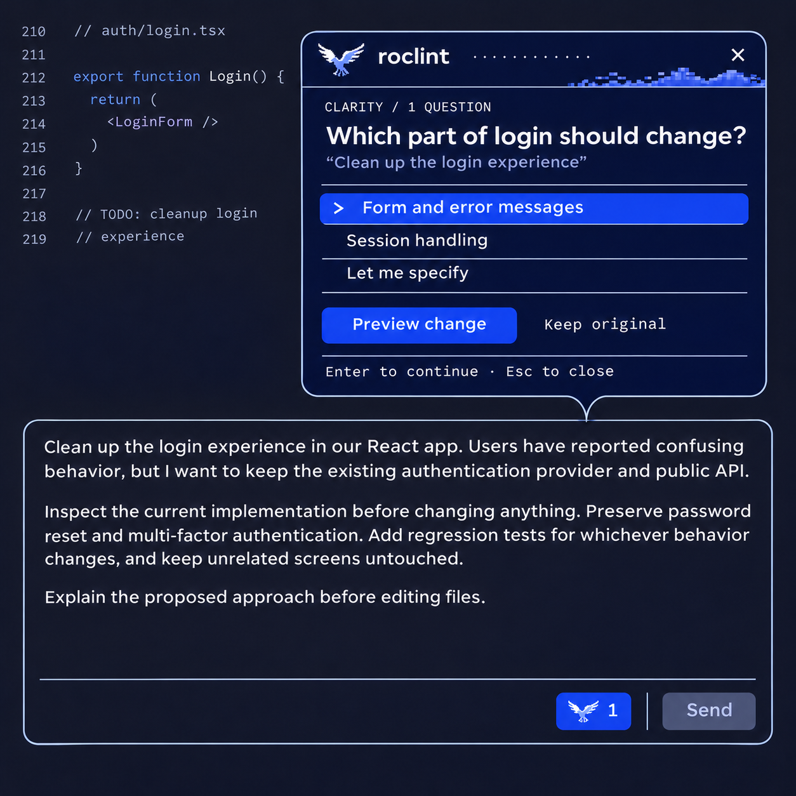
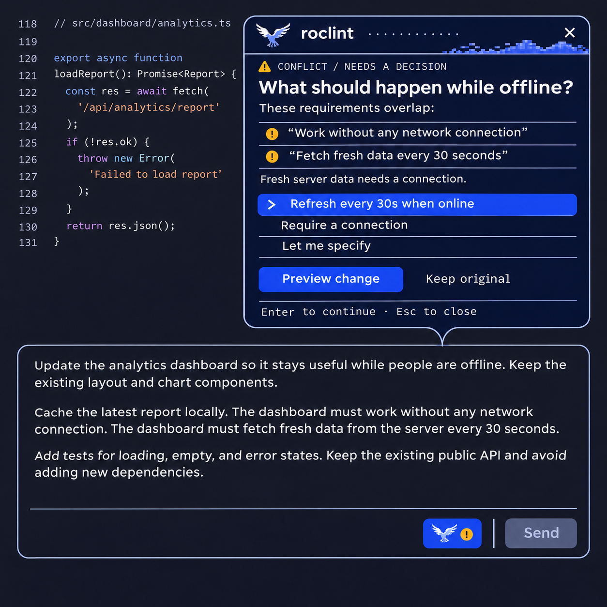
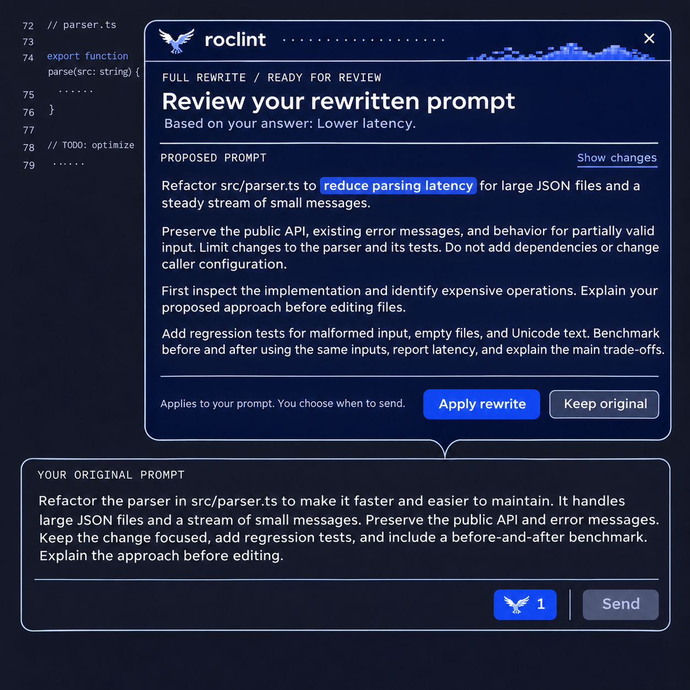

# Roclint UI/UX direction and visual reference archive

Recorded: 2026-11-05, America/Los_Angeles. This is the decision record for the design-planning conversation spanning November 4–5.

Status: **approved visual direction, recorded interaction requirements, proposed refinements**. These are design concepts and planning decisions; the images are not screenshots of implemented Roclint functionality.

## Start here

The user wants Roclint to feel like a polished desktop companion that appears naturally beside the field where they are typing. Grammarly is the reference for unobtrusive widget behavior and useful interaction details. Boat is the reference for the ASCII/pixel, retro-modern visual identity.

**Approved visual baseline:** the dark Console direction, subsequently refined with rounded corners, a Roc bird logo, and a longer prompt. The user selected the second original concept, requested those refinements, then said the revised image looked good.

**Latest interaction requirement takes precedence over the images:** the user can explicitly request a full rewrite from the HUD. Roclint may ask questions, but the user can skip them and receive a best-effort rewrite. A full rewrite must not depend solely on Roclint deciding that one is necessary. The archived scenario mockups were generated before this correction and do not yet show the complete user-initiated rewrite journey.

## User requirements and preferences

The following were explicitly requested or accepted in the conversation:

- Focus on the desktop widget, popups, interaction quality, and installation experience. The user clarified that this discussion is about UI/UX, not expanding Roclint into a general writing assistant.
- Improve how the widget appears while someone is typing and how it opens useful suggestions beside their editor.
- Use an ASCII/retro-modern aesthetic inspired by [boat.dev](https://boat.dev/).
- Use the dark-blue second concept as the starting visual direction.
- Add rounded edges and replace the lettermark with a **Roc bird**.
- Demonstrate longer prompts, not only short idealized examples.
- Show different Roclint situations, including a clarity question and a complete rewrite.
- Let the user ask for a full rewrite directly in the HUD; questions are optional and skippable.
- Add animation and the useful small UX touches associated with Grammarly.
- Replace the BAT-file setup/launch experience with professional app installation and onboarding.
- Preserve this discussion and its images for future reference.

The current work remains planning and visual exploration. Saving this record does not authorize an app implementation, architecture migration, deployment, or installer release.

## Visual direction

The approved concept combines a charcoal editor backdrop with an ink-blue Roclint surface, cobalt actions and selection highlights, warm-white reading text, and fine pale-blue borders. It uses rounded panel and control corners, a white pixel Roc bird with spread wings, a lowercase `roclint` wordmark, and a restrained pixel motif in the header.

Monospace works for short category labels, counters, keyboard hints, and status. Longer questions and prompt text use readable modern sans-serif type. Keep the character of ASCII/pixel graphics while maintaining comfortable reading sizes and clear hierarchy.

Exact fonts, color tokens, radii, spacing, and logo geometry are **not yet a finalized design system**. Image-generation prompts used indicative sizes, including approximately 16 px outer corners and 8 px control corners; these are starting points rather than approved measurements. The bird in the images is a concept mark, not a finished reusable logo asset.

### Reference roles

| Reference | Role in Roclint |
|---|---|
| [Boat](https://boat.dev/) | Blue palette, pixel/ASCII character, fine framing, monospace accents, modern readable typography |
| [Grammarly desktop guide](https://support.grammarly.com/hc/en-us/articles/4412816078349-Grammarly-for-Windows-and-Grammarly-for-Mac-user-guide) | Widget near the writing field, suggestion cards, count, moving/anchoring behavior |
| [Grammarly keyboard guide](https://support.grammarly.com/hc/en-us/articles/24059143083277-Can-I-use-my-keyboard-to-navigate-Grammarly-for-Windows-and-Mac) | Keyboard access to the assistant and suggestions |
| [Grammarly app controls](https://support.grammarly.com/hc/en-us/articles/4406998780813-How-to-choose-where-Grammarly-for-Windows-and-Mac-works) | Per-app/site control over where the assistant operates |

Boat's hero and feature panels were inspected during the conversation. Its website remains a linked source; the seven PNGs archived here are the generated Roclint concepts. These references express inspiration, not a requirement to reproduce either product's branding or implementation.

## Planned interaction model

### Collapsed badge

The proposed badge stays near the active prompt field and remains unobtrusive while the user types. After a short pause, it can indicate checking or available suggestions without opening a large window or taking keyboard focus. Clicking the badge or using the shortcut opens the HUD.

States to design include idle/quiet, checking, suggestions available, no suggestions needed, and unavailable. Counts should reflect actual available items. The badge should support repositioning when it overlaps editor controls; remembering its anchor per app is a proposed enhancement.

### HUD entry actions

Two directly accessible actions were proposed to satisfy the user's control requirement:

- **Review prompt:** ask Roclint to check the draft and surface useful questions or suggestions.
- **Rewrite prompt:** explicitly request a full rewrite whenever the user wants one.

Exact labels and visual priority still need a concept pass. An automatic check or a low issue count must not remove the user's route to a full rewrite.

### Optional clarification during rewrite

The intended journey is:

1. The user opens the HUD and requests **Rewrite prompt**.
2. Roclint may offer a relevant clarification question.
3. The user can answer, skip a question, or choose **Skip questions & rewrite**.
4. Roclint produces its best effort from the original prompt and any answers the user supplied.
5. The user reviews the proposed prompt and applies it explicitly.

Skipping should not be treated as confirming a specific answer. Preserve stated requirements and keep unspecified details broad where possible. Where a rewrite uses an interpretation or leaves a detail unresolved, disclose that concisely in the preview rather than presenting it as a user-confirmed decision. For incompatible requirements, expose the unresolved choice or interpretation in the preview instead of silently claiming both have been satisfied.

Suggested wording from the discussion includes **Details left open**, **Try again**, and a follow-up instruction such as “shorter,” “more detailed,” or “keep my wording.” These are proposed UX treatments, not individually finalized controls.

### Suggestion popup

The proposed everyday popup shows one useful question or suggestion at a time, a relevant literal excerpt from the prompt, a small set of choices or a manual answer, and a clear way to keep the original. It should preserve the user's place in the editor and remain anchored without covering important typing controls.

A long original prompt stays in the editor. The popup quotes only the relevant fragment. A rewrite preview can grow into the larger review surface when the complete proposed text needs more space. Sizes should adapt to the screen and content; mockup dimensions are illustrative.

### Expanded rewrite review

Show the entire proposed prompt legibly, with access to the original and specific changes. Use **Apply rewrite** as the primary action, with **Keep original** and useful retry/refinement controls available without crowding.

Applying puts the approved text into the prompt field and returns the user to their editor. The user chooses when to submit it. The design discussion did not request automatic sending. An application confirmation with **Undo** was proposed; reliable undo behavior still needs implementation design and validation.

## Motion and small UX details

The user requested animation and Grammarly-like polish. The following are proposals to carry into the next design pass:

| Moment | Proposed behavior |
|---|---|
| Badge becomes relevant | Quick fade with slight movement after typing pauses |
| Checking or writing | Subtle pixel Roc wing animation and an honest status label |
| Question becomes a rewrite preview | Smooth resize and content transition, with stable anchoring |
| Apply completes | Brief applied confirmation and accessible undo |
| A question is selected | Highlight its relevant source phrase where the integration supports it |
| User dismisses a suggestion | Stay quiet until a meaningful draft change |

Other proposed details: movable anchors remembered per app, keyboard navigation and visible shortcuts, accepting/dismissing individual suggestions, per-app pausing, clear loading and failure states, and reduced-motion support. Exact timing, easing, animation assets, shortcuts, and pause durations remain open.

No animation was generated or implemented in this conversation; the PNGs show static states. Inline source highlighting is also a design proposal whose support will depend on the editor integration.

## Installation and onboarding

The user explicitly wants the BAT-file setup removed from the user experience. The proposed replacement is a normal desktop installer and launch path, a Start-menu entry, and resident tray behavior.

First-run onboarding should manage local model/runtime setup inside the app, with understandable progress, recoverable errors, and pause/resume where feasible. Dependencies should be handled by the app rather than manual shell steps. Updates, code signing, clean uninstall, and startup preferences belong in the delivery plan. The packaging technology and exact update mechanism have not been selected.

The visual direction can extend to installer/model-download screens through a small pixel/ASCII illustration, consistent typography, and the Roc bird. Those screens have not yet been mocked up.

## Image gallery and decision history

All seven generated images are embedded below or above and copied beside this document. They remain available independently of the image-generation cache. The original generation files were also preserved.

### Initial exploration: Signal / light

First displayed concept in the original three-image set. Historical exploration; not the selected baseline.

### Initial exploration: Console / dark, selected

Second displayed concept in that original set. This is the user's selection of “number 2.” It predates the rounded corners and Roc bird refinement.

### Initial exploration: Field Notes / wide

Third displayed concept in the original set. Historical exploration; not the selected baseline.

### Approved refinement: rounded corners, Roc bird, long prompt

The full approved image is embedded at the top of this document. Use [that saved baseline](roclint-ux-2026-11-05-approved-rounded-roc-long-prompt.png) as the visual source for further work.

### Scenario: clarity question

Explores asking which part of an ambiguous login request should change. This is an example of a question state within the approved style.

### Scenario: conflicting requirements

Explores offline dashboard operation alongside a fresh-server-data requirement. It shows the requirements together and offers a decision. The later user requirement makes clarification optional during a requested rewrite; the next version needs the skip path.

### Scenario: complete rewrite review

Explores the larger review panel after a lower-latency answer. It is an example of the preview surface, not a rule that a rewrite requires answering a question first. Generated text in mockups is illustrative; implementation must preserve filenames and requirements from the actual frozen prompt rather than transcribing image text.

## What the next concept pass should cover

1. The HUD with an explicit **Rewrite prompt** entry action.
2. An optional question with an obvious **Skip questions & rewrite** route.
3. A best-effort rewrite preview, including concise disclosure of details left open when needed.
4. The smaller everyday states: collapsed, checking, no suggestions needed, missing detail, and unavailable/retry.
5. Motion between those states, focus/keyboard behavior, placement near screen edges, and reduced motion.
6. Installer and first-run model download, followed by updater/uninstaller planning.

Open design decisions include final logo artwork, exact tokens and dimensions, whether any small mascot motion belongs beyond checking, how per-app pausing is surfaced, and the exact retry/refinement controls. Do not reinterpret the image gallery as a choice between the scenario states; they are different uses of the same approved direction.

## Preservation and provenance

- Generated with the built-in Image Gen tool from the Boat reference screenshots, conversation brief, and approved previous concept.
- Original generation directory: `C:\Users\kirby\.codex\generated_images\01a1a9e9-b0d2-7d51-8d97-6d0f10c8d771`.
- Copies in this repository use descriptive names and portable relative links.
- Copies are also stored in `C:\Users\kirby\.codex\state\plugins\product-design\assets`, with a curated entry in the adjacent `user-context.md`, so future Product Design work has a starting map.
- Repository HEAD when archived: `0a17b8d7aaf1c8060db9be4bcd589475be5c35bc`. The workspace already contained ongoing implementation changes. This archive adds design references and does not modify those implementation files.

| Archived file | Original generation file |
|---|---|
| `roclint-ux-2026-11-05-exploration-signal-light.png` | `exec-2e65bb86-b399-4809-aaf1-f37c546b4225.png` |
| `roclint-ux-2026-11-05-exploration-console-selected.png` | `exec-e6df4550-b4fc-4ef1-989f-29bb5afe47cd.png` |
| `roclint-ux-2026-11-05-exploration-field-notes.png` | `exec-55e3588c-a6d8-4a61-b342-f7bb246da53b.png` |
| `roclint-ux-2026-11-05-approved-rounded-roc-long-prompt.png` | `exec-6fe22b69-858b-4424-b063-97929b563cf6.png` |
| `roclint-ux-2026-11-05-scenario-clarity-question.png` | `exec-0528ed6a-6720-433d-b7bd-44c30f767e69.png` |
| `roclint-ux-2026-11-05-scenario-conflicting-requirements.png` | `exec-8dae1934-bf97-466f-bc6c-148967953d53.png` |
| `roclint-ux-2026-11-05-scenario-full-rewrite-review.png` | `exec-20eafb79-b86b-491f-ae3b-93483e5e0146.png` |
